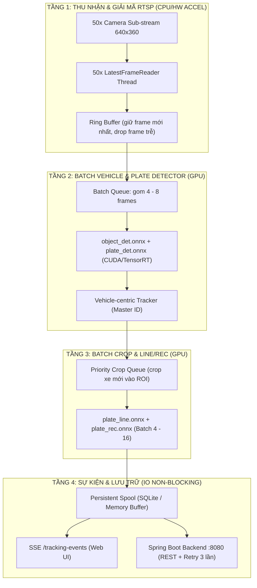

# KẾ HOẠCH BENCHMARK & CHUẨN HÓA KIẾN TRÚC ĐA LUỒNG HỆ THỐNG ALPR (50 CAMERA)

> **Mục tiêu**: Đảm bảo hệ thống vận hành ổn định, không gián đoạn (zero-crash), không rò rỉ bộ nhớ (zero-leak), đạt chuẩn throughput $\ge 500\text{ FPS}$ cho 50 camera đồng thời với tỷ lệ nhận diện $\ge 98.5\%$.
>
> **Phiên bản v2 (review 2026-10-29)**: Sửa lỗi phương pháp đo Stage 2, thêm thiết kế nhận diện **đa biển mật độ cao** (nhiều xe sát nhau / bám đuôi), đánh dấu rõ số liệu giả định, bổ sung kịch bản soak + chaos thực thi được. Thay đổi chính so với v1 được liệt kê ở mục **0**.

---

## 0. TÓM TẮT THAY ĐỔI SO VỚI v1

| # | Chủ đề | v1 | v2 (hiện tại) |
|---|---|---|---|
| 1 | Input `plate_line.onnx` | 48×192 | **320×320** (đo thực tế từ shape model) |
| 2 | Mục tiêu GPU Stage 1 | Ngưỡng "tăng tốc 20x" ghi như đã có | Đánh dấu rõ là **giả định chưa đo**, bắt buộc chạy lại trên `CUDAExecutionProvider` |
| 3 | Stage 2 throughput | Dùng `processed_frames / t_total` (gồm cả thời gian join thread khi stop) | Đo trên **active window**, tách thời gian graceful-stop; thêm metric **detection invocations/s** (vì `frame_skip=3` → detector chỉ chạy 1/3 frame) |
| 4 | Stage 2 "target 10 FPS/cam" | Feeder khóa xử lý trong loop, không giữ được 10 FPS | **Injection rate cố định** độc lập tốc độ AI + ring-buffer drop (mô phỏng `LatestFrameReader`) |
| 5 | p95/p95 queue latency | Chưa đo (chỉ in console, không vào report) | Tag `enqueued_at` trên task OCR, đo p95/p99 khi dequeue; **lưu `OcrBenchmark` vào report** |
| 6 | Exception trong feeder | `except Exception: pass` (claim "zero crash" rỗng) | Đếm & ghi số exception vào report |
| 7 | Decode RTSP (Tầng 1 kiến trúc) | Chưa test (Stage 2 dùng video RAM) | Thêm mốc **decode RTSP sub-stream qua MediaMTX** đo CPU |
| 8 | "Zero memory leak" | Test 15s/mốc | Soak **24–72h**, theo dõi **dốc** RAM/VRAM theo thời gian |
| 9 | Bảng accuracy Stage 3 (5/10/15/25 FPS) | Số % ghi như dữ liệu đã có | Đánh dấu rõ là **giả định**, kèm **protocol đo** để thay bằng số thật |
| 10 | Multi-plate dense traffic | Không có | **Mục IV mới**: thiết kế nhận diện đa biển trong khung hình & frame kế tiếp (nhiều làn + bám đuôi) |
| 11 | Path mặc định | Cứng chỉ ngoài repo (`D:\...\` , `C:\Users\Tuna\.gemini\...`) | Đường dẫn relative trong repo hoặc bắt buộc qua CLI |

---

## I. ĐÁNH GIÁ TỔNG QUAN PHƯƠNG PHÁP

Phương pháp 4 giai đoạn (đơn lẻ model → bậc thang tải → accuracy → soak) đúng chuẩn Production-Grade. Bản v2 giữ nguyên xương sống, chỉ **sửa cách đo** và **bổ sung kịch bản đa biển** (mục IV) để phản ánh traffic thực tế: nhiều xe chạy song song, bám đuôi, không phải "1 xe 1 làn".

---

## II. KIẾN TRÚC ĐA LUỒNG TỐI ƯU (GIỮ V1, ĐIỀU CHỈNH 2 ĐIỂM)

Kiến trúc Producer–Consumer tách rời 4 tầng giữ nguyên như v1:



Điều chỉnh so với v1:
- **Tracker = Vehicle-centric** (không phải "ByteTrack / SORT tracker trên từng camera" chung chung): track **thân xe** (Tầng 1) là master ID, track biển số gắn vào ID xe. Lý do: trong dense traffic, biển số dễ bị mất dấu 1–2 frame (motion blur, che khuất, detector miss) còn thân xe ổn định hơn nhiều → gắn biển vào xe giúp **không bị ID-switch** giữa hai xe chạy sát nhau. Chi tiết ở **mục IV**.
- **Input `plate_line.onnx` = 320×320** (theo shape thật của model, không phải 48×192 như v1).

3 nguyên tắc cốt lõi (giữ v1, bổ sung 1):
1. Sub-stream 640×360 hoặc 960×540 cho AI; Full HD cho MediaMTX WebRTC.
2. Không chạy inference tuần tự trong thread camera — gom batch dùng chung 1 GPU worker.
3. Bounded queue + dropping policy (max 2 frame/camera ở detector).
4. **Mới**: Số worker OCR / camera `per_cam_limit` phải ≥ (số làn + độ bám đuôi dự kiến), xem **IV.4**.

---

## III. KẾ HOẠCH TRIỂN KHAI BENCHMARK CHI TIẾT (4 GIAI ĐOẠN, ĐÃ SỬA CÁCH ĐO)

### GIAI ĐOẠN 1: Benchmark Đơn Lẻ Từng Model & Tìm Kích Thước Batch Tối Ưu

> **Bắt buộc chạy trên CẢ CPU lẫn GPU.** Mọi con số GPU trong bản v1 là **giả định** — chỉ có chạy `CUDAExecutionProvider` thật mới được phép kết luận "500 FPS khả thi".

| Model | Nhiệm vụ | Input (thực tế) | Test Batch | Ngưỡng mục tiêu CPU (đã đo) | Mục tiêu GPU (CHƯA ĐO) |
|---|---|---|---|---|---|
| `object_det.onnx` | Phát hiện xe & người | `[1,3,640,640]` | 1,4,8,16 | ~133 ms p50 (B=1, CPU) | ≤ 12 ms (B=4) — **hypothesis** |
| `plate_det.onnx` | Định vị biển | `[1,3,640,640]` | 1,4,8,16 | ~126 ms p50 (B=1, CPU) | ≤ 8 ms (B=4) — **hypothesis** |
| `plate_line.onnx` | Tách dòng 1 vs 2 | `[1,3,320,320]` | 1,4,8,16 | ~30 ms (B=1) | **hypothesis** |
| `plate_rec.onnx` | CTC nhận chữ | `[B,3,48,320]` | 1,4,8,16,32 | ~15 FPS ổn định theo batch (B=1→32) | **hypothesis** |
| **Full Pipeline** | 4 tầng | — | Dynamic | ~508 ms/luồng (≈ 2 FPS) | ≤ 35 ms/frame — **hypothesis** |

Thủ tục đo: warmup 3 lần, 20 lần lặp, báo mean/p50/p95/FPS theo batch; so CPU vs GPU để **xác nhận** thay vì dự phóng mục tiêu 500 FPS.

---

### GIAI ĐOẠN 2: Tăng Tải Bậc Thang (10 → 25 → 50 Camera) — CÁCH ĐO ĐÃ CHỈNH SỬA

**Yêu cầu phương pháp (mỗi mục = một bug của v1 đã sửa):**

1. **Injection rate cố định, độc lập tốc độ AI** — feeder đẩy frame theo mốc 10 FPS bằng timer riêng, **không** `sleep(interval - processing_time)`. Khi AI chậm hơn 100ms/frame, v1 chỉ inject được 1–2 FPS thật, làm sai cả bảng "Target 10 FPS".
2. **Mô phỏng `LatestFrameReader` bằng ring-buffer** — mỗi camera giữ tối đa 1–2 frame, **drop frame cũ** khi queue đầy (drop-policy thật của sản phẩm), không chạy inline như v1.
3. **Throughput đo trên active window** (vd 15s) — **không** bao gồm thời gian `join` thread khi stop. Thời gian graceful-stop đo **riêng** và ghi ra report (v1 giấu ~70s stop vào con số throughput của mốc 3).
4. **Phân biệt rõ 3 metric** (không dùng chung `processed_frames`):
   - `detection_invocations/s` (chỉ tính frame chạy thật detector, vì `frame_skip=3` → 1/3 frame)
   - `ocr_submissions/s`
   - `plate_events/s` (số biển số được chốt event)
5. **p95/p99 queue latency** — mỗi task OCR được tag `enqueued_at`; khi worker dequeue, đo `dequeue - enqueued_at`; ghi p95/p99 vào report (mục tiêu p95 < 100ms, p99 < 200ms). Đồng thời **lưu `OcrBenchmark` (p50/p95 mỗi tầng) vào report**, không chỉ in console.
6. **Đếm exception** — thay `except: pass` bằng bộ đếm; ghi số exception + traceback rút gọn vào report. "Zero crash" chỉ hợp lệ khi số exception = 0.
7. **Mốc decode RTSP (mới)** — ngoài video RAM, chạy thêm 1 mốc với **50 luồng RTSP sub-stream 640×360 qua MediaMTX** để đo CPU tầng decode thật (v1 bỏ qua hoàn toàn tầng 1 của kiến trúc).
8. **Chạy lại trên GPU** — sau Stage 1, chạy nguyên bộ Stage 2 trên `CUDAExecutionProvider` để có số thật cho 500 FPS.

| Mốc | Số cam | Injection | Thời lượng | Metric bắt buộc |
|---|---|---|---|---|
| Mốc 1 | 10 | 10 FPS | 30s (v1 chỉ 15s) | detection/ocr/event FPS, p95/p99, CPU, RAM, VRAM, exception=0 |
| Mốc 2 | 25 | 10 FPS | 30s | như Mốc 1 + graceful-stop time |
| Mốc 3 | 50 | 10 FPS | 30s | như Mốc 2 |
| Mốc 4 (mới) | 50 | 10 FPS, **RTSP thật** | 30s | + decode CPU |

---

### GIAI ĐOẠN 3: Đánh Giá Độ Chính Xác & Đa Biển (Ground-Truth)

> ⚠️ **Số % trong bảng dưới là GIẢ ĐỊNH của v1** (94.2%, 98.6%... chưa được đo). Giữ lại làm mốc so sánh, nhưng **bắt buộc chạy protocol đo** để thay bằng số thật trước khi nghiệm thu.

**Protocol đo (mỗi mốc FPS chạy độc lập, cùng bộ dataset):**
- **Tập bãi đỗ / tĩnh**: xe dừng hoặc < 15 km/h.
- **Tập Gate Burst**: 3–5 xe bám đuôi liên tục (kịch bản đa biển chính, xem mục IV).
- **Tập đêm / ngược sáng**: đèn pha chiếu trực tiếp.
- Cách tính:
  - `Tỷ lệ nhận diện đúng = (số biển đọc đúng theo ground-truth) / (tổng biển ground-truth trong đoạn)`.
  - `Tỷ lệ sót xe = (xe qua tripwire không có event) / (tổng xe qua)`.
  - `Tỷ lệ ID-switch đa biển = (sự kiện xe A gán biển xe B) / tổng sự kiện` — **metric mới, chỉ xuất hiện khi chạy kịch bản đa biển mục IV**.

| Cấu hình FPS (giả định, cần đo lại) | Nhận diện đúng | Sót xe | Ghi chú |
|---|---|---|---|
| 5 FPS | ~94% (đo lại) | ~4.8% (đo lại) | Chỉ bãi đỗ tĩnh |
| 10 FPS | ≥ 98.6% (đo lại) | ≤ 0.8% (đo lại) | **Khuyến nghị cổng** — xác nhận bằng đo |
| 15 FPS | ≥ 99.1% (đo lại) | ≤ 0.3% (đo lại) | Xe > 30 km/h |
| 25 FPS | ≥ 99.2% (đo lại) | ≤ 0.2% (đo lại) | Thường dư tài nguyên |

> Ghi chú: Stage 3 trong **script** hiện tại (component 4) đang là **so sánh tracker Legacy vs ByteTrack** (ID-switch, latency, duplicate event) — khác chủ đề. Giữ lại như 1 component, nhưng **không** thay thế được bảng accuracy 5/10/15/25 FPS ở đây.

---

### GIAI ĐOẠN 4: Soak 24–72h & Chaos (viết lại để đo được)

Kịch bản chaos giữ nguyên ý v1, thêm **metric nghiệm thu cụ thể**:

1. **Rút mạng 5–10 camera / 30s** → đo: thời gian reconnect, zombie thread = 0.
2. **10 tab SSE đồng thời** → đo: CPU SSE hub, socket leak = 0.
3. **Backend down 2 phút** → đo: **Event Loss Rate = 0** (spool giữ, retry bù khi backend về). Đây là metric quan trọng nhất, v1 không có công thức.
4. **Burst 20 xe cùng lúc** → đo: OCR queue size peak, OOM = 0, p99 queue latency.

**Tiêu chuẩn 72h (đo theo thời gian, không chỉ 1 snapshot):**
- RAM & VRAM: **dốc (slope) ≈ 0** khi fit tuyến tính theo giờ (v1 chỉ chụp 1 giá trị 4.4GB — không chứng minh được leak).
- Event Loss Rate = 0 (công thức: `(sự kiện vào spool) - (sự kiện backend nhận được) = 0`).
- Crash / Restart đột ngột = 0.

---

## IV. THIẾT KẾ NHẬN DIỆN ĐA BIỂN MẬT ĐỘ CAO (NHIỀU XE SÁT NHAU / BẮM ĐUÔI)

> **Xác định vấn đề**: Trên đường/cổng thật, cùng một thời điểm có thể có **2–3 biển trên cùng 1 frame** (nhiều làn song song) VÀ **biển của xe bám đuôi chỉ cách 1–2 frame** (xe chạy sát nhau qua cổng). Mục tiêu: **đọc đủ tất cả, không sót, không gán nhầm ID, mỗi xe = đúng 1 event** — chứ không phải giả định "1 xe 1 làn".

Thiết kế xây trên những gì code **đã có** (liệt kê để tránh làm lại), chỉ bổ sung các thiếu sót:

### IV.1. Những gì đã có trong code (không làm lại)

| Khả năng | Vị trí |
|---|---|
| Vehicle-centric: track thân xe (T1) là master, biển gán vào xe (IoU/centroid) | `video_alpr_processor.py` — khối `tracked_vehicles` |
| Temporal voting: `plate_votes` gộp kết quả OCR qua nhiều frame liên tiếp | `TrackedPlate.plate_votes` |
| Best-shot: giữ crop nét nhất cho event | `TrackedPlate.best_crop / best_shot` |
| OCR async parallel: pool dùng chung 1 engine, submit nhiều crop đồng thời | `ocr_worker_pool.py` (`OcrWorkerPool`, `per_cam_limit`) |
| Anti-spam: cooldown 15s theo biển, `frames_lost` + last-chance flush | `TrackedPlate` + drain queue |
| Chọn biển OCR theo frame: ưu tiên chưa đọc > đã cắt tripwire > gần > to | khối chọn `_cand` trong `process_frame` |

### IV.2. Thiết kế cốt lõi (gắn 5 lớp)

**Lớp 1 — Detection (giữ nguyên):** `plate_det.onnx` phát hiện **N biển** trong 1 frame (không phải 1). ROI pre-crop để giảm 60% suy luận.

**Lớp 2 — Association (điểm then chốt cho "nhiều xe sát nhau"):**
- Biển số **kế thừa ID từ xe** (master). Nếu xe A và xe B chạy song song sát nhau: 2 box xe tách biệt → 2 ID khác nhau → 2 biển không bao giờ gán lẫn, dù 2 box biển gần nhau trên ảnh.
- Nếu biển mất dấu **1–2 frame** (motion blur, che khuất, miss detector), **track xe vẫn sống** → frame kế tiếp biển được **re-associate** vào cùng ID xe → không ID-switch. Đây là cách xử lý trực tiếp yêu cầu "nhận diện trong 1–2 frame gần nhau".
- **Hành động cần làm**: (a) kiểm tra ngưỡng re-association hiện tại (IoU / centroid) có đủ lỏng để biển quay lại sau 1–2 frame mất dấu không; (b) **nâng cấp track xe lên ByteTrack** (component đã có trong Stage 3 script) nếu legacy vẫn switch ID khi xe song song — vì ByteTrack xử lý che khuất bằng low-threshold gate tốt hơn.

**Lớp 3 — Nhận diện cửa sổ 1–2 frame (temporal voting):**
- Biển chưa đọc: `frame_gap = 1` → thử OCR ngay frame kế tiếp.
- Cùng 1 biển xuất hiện ở frame `t, t+1, t+2` (do xe chạy chậm hoặc bị nhòe ở `t`) → **gộp vote** qua `plate_votes`; chỉ 1 frame nhòe nhưng 1–2 frame sau nét vẫn đọc được.
- **Chốt nhận diện**: ≥ 2 vote giống nhau, HOẶC 1 vote với conf ≥ 85 + sharpness ≥ 3.
- `best_shot` = crop nét nhất trong cửa sổ ~3 frame → dùng cho snapshot + event.

**Lớp 4 — OCR song song (bùng nổ nhiều biển cùng lúc):**
- Mỗi frame, submit **nhiều crop cùng lúc** vào pool (không lần-lượt). Số biển cho phép đồng thời = `per_cam_limit`.
- **Yêu cầu cấu hình (thiếu so với v1):** `per_cam_limit` phải ≥ **(số làn + độ bám đuôi)**. Ví dụ 2–3 làn + 1 xe bám đuôi → **≥ 4**; khuyến nghị đặt **8** (trần của pool). Nếu để nhỏ (vd 2) thì burst 4–5 xe sẽ **quý hàng đợi**, một số biển bị bỏ qua frame này và đọc trễ → tăng tỷ lệ sót.
- 8 worker chung (cores//2) chia đều → không oversubscribe.

**Lớp 5 — Chốt event (giữ nguyên, thêm metric):**
- Tripwire + vote + last-chance flush (khi `frames_lost ≥ 1` nhưng OCR vừa trả kết quả về) → không sót xe đã rời vùng phát hiện.
- Cooldown 15s theo biển → chống spam.
- Mỗi xe = đúng 1 event.

### IV.3. Kịch bản test "Dense Multi-Plate" (thêm vào Stage 2/3)

Dùng trong benchmark để chứng minh thiết kế IV.2:

- **Kịch bản A — Nhiều làn cùng frame**: nạp video/giả lập có **2–3 biển trong 1 frame**, chạy 30s. Đo: % biển được đọc (mục tiêu = 100%), p95 latency từ lần phát hiện đầu → event chốt.
- **Kịch bản B — Bám đuôi 1–2 frame**: **3–5 biển** cách nhau 1–2 frame (sim xe bám đuôi qua cổng). Đo: % biển đọc đủ (mục tiêu = 100%, không sót xe nào), sự kiện "1 xe 1 event" (không trùng, không gán chéo), số ID-switch (mục tiêu = 0).
- **Kịch bản C — Burst cổng**: 4–5 biển dồn vào cùng 2–3 frame liên tiếp (gate burst). Đo: OCR queue peak, p99 latency, confirm `per_cam_limit` ≥ 4 đã giữ được tất cả.

Metric bổ sung (chưa có trong báo cáo v1):
- `plates_read / plates_injected` (tỷ lệ đọc đủ) theo kịch bản A/B/C.
- `id_switch_between_adjacent_vehicles` (mục tiêu 0).
- `duplicate_events_per_plate` (mục tiêu 0).
- p95 latency **plate-first-detected → event-finalized**.

---

## V. LỘ TRÌNH TRIỂN KHAI (CẬP NHẬT)

```
Tuần 1: Chuẩn hóa script benchmark (sửa M1–M8) + hoàn thiện thiết kế đa biển (Lớp 2 & 4)
├── Sửa injection rate + ring-buffer drop + active window + p95/p99 + đếm exception
├── Kiểm tra/giới hạn re-association (Lớp 2), đặt per_cam_limit = 8 (Lớp 4)
└── Viết kịch bản Dense Multi-Plate A/B/C (IV.3)

Tuần 2: Benchmark GPU thật + chạy Stage 1/2
├── Chạy Stage 1 trên CPU VÀ GPU (CUDA EP) — xác nhận thay vì dự phóng
├── Chạy Stage 2 (10→25→50 + RTSP decode) cả CPU lẫn GPU
└── Xuất biểu đồ + bảng metric mới (detection/ocr/event FPS, p95/p99, exception)

Tuần 3: Accuracy đa biển (Stage 3) + Soak 72h (Stage 4)
├── Đo accuracy 5/10/15/25 FPS trên 3 dataset + kịch bản A/B/C (thay số giả định)
├── Soak 24–72h: dốc RAM/VRAM, Event Loss Rate, 4 chaos scenario
└── Nghiệm thu: đạt 500 FPS (GPU) & đa biển 100% không sót / 0 ID-switch

Nếu chưa GPU ngay: chạy 50 cam ở chế độ "giảm tải"
├── frame_skip → 4, giữ per_cam_limit = 8, ưu tiên FINE tier
└── Ghi rõ SLA giảm (không đạt 500 FPS, chỉ đạt mức X FPS) trong báo cáo
```

---

## VI. CHECKLIST NGHIỆM THU (trước khi ký 50 camera)

- [ ] Stage 1 GPU thật: 4 model đạt mục tiêu latency (không phải giả định).
- [ ] Stage 2: 50 cam @ 10 FPS injection, **detection/ocr/event FPS** ≥ mức SLA, p95 < 100ms, p99 < 200ms, **exception = 0**, graceful-stop tách riêng.
- [ ] Stage 2 RTSP: decode 50 sub-stream qua MediaMTX, CPU tầng decode < ngưỡng.
- [ ] Kịch bản A/B/C (IV.3): `plates_read / plates_injected = 100%`, `id_switch = 0`, `duplicate = 0`, `per_cam_limit` ≥ 4 (khuyến nghị 8).
- [ ] Stage 3: thay toàn bộ số % giả định bằng số đo (5/10/15/25 FPS × 3 dataset).
- [ ] Stage 4: soak 72h, **dốc RAM/VRAM ≈ 0**, **Event Loss Rate = 0**, 4 chaos pass.
- [ ] Nếu chưa GPU: ghi SLA giảm tải rõ ràng, không kết luận "500 FPS".
