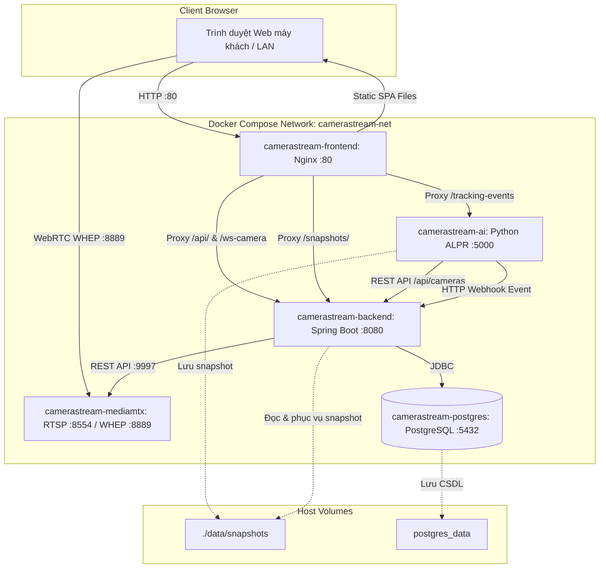

# Kế Hoạch Đóng Gói Trọn Gói Full-Stack (BE + FE + AI + MediaMTX + DB) Chạy Trên Máy Khách & Máy Mình

## 1. Mô Tả Mục Tiêu (Goal Description)
Đóng gói toàn bộ hệ thống CameraStream thành một bundle hoàn chỉnh trong Docker Compose để bất kỳ máy nào (máy dev của bạn hoặc máy tính Windows/Linux của khách hàng) chỉ cần cài Docker và chạy **1 lệnh duy nhất**:
```bash
docker compose up -d --build
```
Hệ thống sẽ tự động khởi chạy và sẵn sàng sử dụng:
1. **Frontend (React Vite)**: Đóng gói qua Nginx (cổng `80` hoặc `3000`), phục vụ giao diện Web giám sát, tự động tương thích khi truy cập từ `localhost`, IP mạng LAN (`192.168.x.x`), hoặc Domain.
2. **Backend (Spring Boot 3 / Java 17)**: Đóng gói qua multi-stage Dockerfile (Maven build + JRE 17 runtime, cổng `8080`), tự động migrate CSDL qua Flyway, kết nối trực tiếp với PostgreSQL và MediaMTX trong mạng Docker.
3. **AI Service (Python 3.10 / ONNX Runtime)**: Đang chạy ổn định, kết nối trực tiếp tới Backend qua mạng nội bộ Docker (`http://backend:8080`).
4. **MediaMTX**: Nhận RTSP (`8554`), phát WebRTC WHEP (`8889`) độ trễ `< 0.2s`.
5. **PostgreSQL 15**: Lưu trữ dữ liệu, tự động tạo tables và tài khoản mặc định.
6. **Thư mục ảnh Snapshot chung**: `./data/snapshots` được mount đồng bộ giữa Backend và AI Service.

---

## 2. Kiến Trúc Mạng & Điều Hướng (Network & Routing Architecture)



---

## 3. Các Vấn Đề Cần Chuẩn Hóa Khi Chạy Trên Máy Khách

> [!IMPORTANT]
> **Khắc phục triệt để các URL hardcode "localhost"**:
> - Hiện tại trong Frontend (`CameraStream-FE`), nhiều file đang hardcode `http://localhost:8080` hoặc `http://localhost:5000`. Khi khách truy cập từ máy khác trong mạng LAN (`http://192.168.1.50`), trình duyệt trên máy họ sẽ cố gọi tới `localhost:8080` (chính máy họ) và báo lỗi không kết nối được!
> - **Giải pháp**: Xây dựng module cấu hình tập trung `envConfig.ts` sử dụng `window.location.hostname`. Khi mở ở bất kỳ IP nào, Frontend tự động trỏ tới đúng IP máy chủ đó.
> - Nginx Reverse Proxy ở cổng 80 sẽ proxy các request `/api/`, `/ws-camera`, `/snapshots/`, `/tracking-events` về đúng các container backend/ai nội bộ. Khách chỉ cần mở `http://<IP_MÁY_CHỦ>`.

> [!TIP]
> **Biến môi trường `.env` linh hoạt cho cả máy Dev và máy Khách**:
> - Tạo file `.env` mẫu (`.env.example`) và `.env` tự nhận diện:
>   - `HOST_IP=localhost` (đổi thành IP mạng LAN như `192.168.1.100` khi muốn các máy khác cùng mạng xem được camera).
>   - `FRONTEND_PORT=80` (hoặc `3000` nếu cổng 80 bị chiếm bởi IIS/Skype).
>   - `DB_USER=postgres`, `DB_PASSWORD=postgres`, `DB_NAME=camerastream_db`.

---

## 4. Các Thay Đổi Cụ Thể (Proposed Changes)

### 4.1. [NEW] `CameraStream/Dockerfile` (Backend Spring Boot)
- **Multi-stage build**:
  - Stage 1 (`maven:3.9.6-eclipse-temurin-17-alpine`): Copy `pom.xml`, tải dependencies, build ra file `app.jar` (skip tests để build cực nhanh).
  - Stage 2 (`eclipse-temurin:17-jre-alpine`): Tạo runtime image siêu nhẹ (~160MB).
- **Environment defaults**:
  - `DB_HOST=postgres`
  - `DB_PORT=5432`
  - `MEDIAMTX_API_URL=http://mediamtx:9997`
  - `SNAPSHOT_STORAGE_PATH=/data/snapshots`
- **Volume mount**: Mount thư mục `/data/snapshots` và `/data/backup`.

```dockerfile
# Stage 1: Build JAR
FROM maven:3.9.6-eclipse-temurin-17-alpine AS builder
WORKDIR /build
COPY pom.xml .
RUN mvn dependency:go-offline -B
COPY src ./src
RUN mvn clean package -DskipTests -B

# Stage 2: Runtime
FROM eclipse-temurin:17-jre-alpine
WORKDIR /app
RUN apk add --no-cache curl tzdata
ENV TZ=Asia/Ho_Chi_Minh
COPY --from=builder /build/target/*.jar app.jar
EXPOSE 8080
ENTRYPOINT ["java", "-Djava.security.egd=file:/dev/./urandom", "-jar", "app.jar"]
```

---

### 4.2. [NEW] `CameraStream-FE/Dockerfile` & `CameraStream-FE/nginx.conf` (Frontend React)
- **Multi-stage build**:
  - Stage 1 (`node:20-alpine`): Cài `package.json`, chạy `npm run build` tạo thư mục `dist/`.
  - Stage 2 (`nginx:alpine`): Phục vụ file tĩnh và reverse proxy các API.
- **`nginx.conf`**:
  - `try_files $uri $uri/ /index.html;` (hỗ trợ routing SPA).
  - Reverse proxy `/api/` -> `http://backend:8080/api/`
  - Reverse proxy `/ws-camera` -> `http://backend:8080/ws-camera` (có `Upgrade` & `Connection` cho WebSocket).
  - Reverse proxy `/snapshots/` -> `http://backend:8080/snapshots/`
  - Reverse proxy `/tracking-events` -> `http://ai-service:5000/tracking-events` (`proxy_buffering off;` cho SSE).

---

### 4.3. [MODIFY] `CameraStream-FE` URL Dynamic Resolution
Tạo module [`envConfig.ts`](file:///d:/HOANGPHAT-PROJECT/CAMERA_WEB_STREAM/CameraStream-FE/src/shared/utils/envConfig.ts):
- `getBackendBaseUrl()`: Tự động trả về `${protocol}//${hostname}:8080` (hoặc relative `/api` khi đi qua Nginx).
- `getWsUrl()`: Tự động trả về `${wsProtocol}//${hostname}:8080/ws-camera`.
- `getAiBaseUrl()`: Tự động trả về `${protocol}//${hostname}:5000`.
- `resolveWebrtcUrl(url)`: Tự động thay thế `localhost`/`127.0.0.1` bằng `window.location.hostname` để khi khách truy cập từ máy khác trong mạng LAN, luồng WebRTC WHEP tự kết nối về IP của máy chủ host MediaMTX.

Cập nhật các điểm gọi:
- [imageUrl.ts](file:///d:/HOANGPHAT-PROJECT/CAMERA_WEB_STREAM/CameraStream-FE/src/shared/utils/imageUrl.ts)
- [App.tsx](file:///d:/HOANGPHAT-PROJECT/CAMERA_WEB_STREAM/CameraStream-FE/src/App.tsx)
- [CameraStreamView.tsx](file:///d:/HOANGPHAT-PROJECT/CAMERA_WEB_STREAM/CameraStream-FE/src/components/CameraStreamView.tsx)
- [SpotlightDrawer.tsx](file:///d:/HOANGPHAT-PROJECT/CAMERA_WEB_STREAM/CameraStream-FE/src/features/video-wall/components/SpotlightDrawer.tsx)
- [AuthContext.tsx](file:///d:/HOANGPHAT-PROJECT/CAMERA_WEB_STREAM/CameraStream-FE/src/core/auth/AuthContext.tsx)

---

### 4.4. [MODIFY] Root `docker-compose.yml`
Thêm 2 service `backend` và `frontend`:
- `backend`:
  - `build: ./CameraStream`
  - `container_name: camerastream-backend`
  - `depends_on: [postgres, mediamtx]`
  - `environment:`
    - `DB_HOST=postgres`
    - `MEDIAMTX_API_URL=http://mediamtx:9997`
    - `MEDIAMTX_WEBRTC_URL=http://${HOST_IP:-localhost}:8889`
    - `MEDIAMTX_RTSP_URL=rtsp://${HOST_IP:-localhost}:8554`
    - `SNAPSHOT_STORAGE_PATH=/data/snapshots`
    - `SNAPSHOT_BASE_URL=http://${HOST_IP:-localhost}:8080/snapshots`
  - `volumes:`
    - `./data/snapshots:/data/snapshots`
    - `./data/backup:/data/backup`
  - `ports: ["8080:8080"]`

- `frontend`:
  - `build: ./CameraStream-FE`
  - `container_name: camerastream-frontend`
  - `depends_on: [backend, ai-service]`
  - `ports: ["${FRONTEND_PORT:-80}:80"]`

- `ai-service`:
  - Đổi `BACKEND_URL=http://backend:8080` (kết nối nội bộ mạng Docker thay vì qua `host.docker.internal`).

---

### 4.5. [NEW] File cấu hình môi trường `.env` và hướng dẫn chạy cho khách
- Tạo file `.env` với các giá trị mặc định tối ưu:
  ```env
  HOST_IP=localhost
  FRONTEND_PORT=80
  DB_NAME=camerastream_db
  DB_USER=postgres
  DB_PASSWORD=postgres
  AI_OCR_MAX_TOTAL=8
  AI_TRACKER=bytetrack
  AI_TRACK_OUTSIDE_ROI=0
  ```
- Thêm file hướng dẫn `HUONG_DAN_CAI_DAT_MAY_KHACH.md`:
  - Bước 1: Cài đặt Docker Desktop.
  - Bước 2: Chạy `docker compose up -d`.
  - Bước 3: Mở trình duyệt `http://localhost`. Đăng nhập tài khoản mặc định `admin` / `password`.

---

## 5. Kế Hoạch Xác Minh (Verification Plan)

### Automated Build Verification
1. Chạy build thử nghiệm Dockerfile Backend:
   ```bash
   docker build -t camerastream-backend ./CameraStream
   ```
2. Chạy build thử nghiệm Dockerfile Frontend:
   ```bash
   docker build -t camerastream-frontend ./CameraStream-FE
   ```
3. Chạy `docker compose config` để kiểm tra cú pháp toàn bộ stack.

### Manual Verification
1. Khởi động toàn bộ stack bằng `docker compose up -d`.
2. Kiểm tra log khởi động:
   - `postgres`: database initialized.
   - `backend`: Flyway migrations executed (V1 -> V11), Spring Boot started on port 8080.
   - `ai-service`: connected to `http://backend:8080/api/cameras`.
   - `frontend`: Nginx serving on port 80.
3. Mở trình duyệt tại `http://localhost`:
   - Đăng nhập `admin` / `password`.
   - Kiểm tra hiển thị danh sách camera, live stream WebRTC, toạ độ bám biển số AI (SSE) và danh sách lịch sử nhận diện kèm ảnh snapshot.
